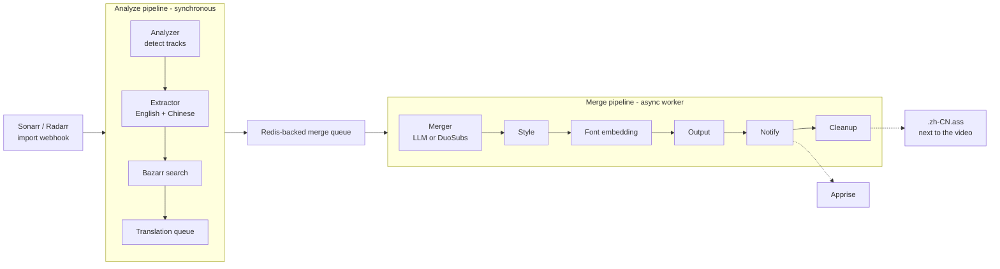

```
   ___           _                  
  / _|_   _ ___(_) ___  _ __  _ __  
 | |_| | | / __| |/ _ \| '_ \| '_ \ 
 |  _| |_| \__ \ | (_) | | | | | | |
 |_|  \__,_|___/_|\___/|_| |_|_| |_|
```

# fusionn

Bilingual subtitle automation for Sonarr and Radarr media libraries.

[](https://github.com/weizsw/fusionn/actions/workflows/ci.yml)
[](go.mod)
[](LICENSE)

fusionn listens for Sonarr/Radarr import webhooks, finds the English and Chinese subtitle tracks in the new file, and writes a styled bilingual `.zh-CN.ass` back to the media directory. If the Chinese subtitle is missing, it can search Bazarr for one, or queue a translation job for an external service such as [fusionn-subs](https://github.com/weizsw/fusionn-subs) and merge the result when the callback arrives.

## How it works



The merge runs on a bounded worker queue, so a slow LLM request never blocks the webhook response.

## Features

| | |
|---|---|
| **Zero-text-hallucination LLM merge** | The model only returns subtitle ID mappings (`en_ids`, `zh_ids`, `layer`). Every line of text and every timestamp is copied from the source files by local deterministic code. |
| **Legacy DuoSubs engine** | Keep the existing semantic aligner (local binary or HTTP service) by setting `subtitle.engine: duosubs`. |
| **Automatic subtitle sourcing** | Extract embedded tracks, ask Bazarr to download a Chinese subtitle, or queue a translation job on Redis and merge on callback. |
| **Traditional to Simplified conversion** | OpenCC `t2s` applied before merging, with the conversion recorded in the cache fingerprint. |
| **ASS styling for TV playback** | 1920x1080 script canvas, Chinese above English, letterbox-aware placement and scale, with a documented geometry model. |
| **Font embedding** | Referenced fonts are subset to the used glyphs and embedded into the ASS file, so playback does not depend on installed fonts. |
| **Word-level timing (optional)** | A bundled CPU service (`Qwen/Qwen3-ForcedAligner-0.6B-hf`) supplies real word times when a long cue must be split. Without it, fusionn falls back to proportional timing. |
| **Caching** | Model request cache keyed on source text, model, prompt and window settings. Changing only the style reuses the cached alignment. |
| **Notifications** | Optional Apprise notifications on success and failure. |

## Requirements

- Go 1.23 or later (local builds) or Docker
- `ffmpeg` and `ffprobe` on `PATH` (included in the Docker image)
- An OpenAI-compatible chat endpoint, for `engine: llm`
- Redis, only for the translation queue
- Python 3, only to run the `word-align` service tests

## Quick start

### Docker Compose

1. Copy the example configuration and edit it:

   ```bash
   cp config/config.example.yaml config/config.yaml
   ```

2. Set `subtitle.enabled: true`, choose an engine, and point `subtitle.llm.base_url` at a reachable model endpoint. Inside a container, `localhost` is the container itself.

3. Point the media volume in `docker-compose.yml` at your library:

   ```yaml
   volumes:
     - /path/to/your/media:/media
   ```

4. Start the stack:

   ```bash
   docker compose up -d --build
   docker compose logs -f
   ```

Compose starts three services: `fusionn`, `word-align` (optional CPU alignment) and `redis`. A commented `fusionn-subs` service shows how to add translation.

> [!NOTE]
> The first `word-align` request downloads the alignment model into the Hugging Face volume. The model worker exits after 300 seconds of inactivity to release memory and reloads from cache on the next request. Set `ALIGN_IDLE_SECONDS` on the service to change this. The service writes one unified log line per event to stderr (`request_completed` per alignment request; health checks stay silent at INFO); set `LOG_LEVEL` (or `ALIGN_LOG_LEVEL` as a fallback alias; default `INFO`) to change what it records.

### Local development

```bash
cp config/config.example.yaml config/config.yaml
make run
```

Or build a binary:

```bash
make build
./fusionn
```

### Webhook setup

Point Sonarr and Radarr at fusionn, **Settings → Connect → Webhook**:

| Field | Value |
|---|---|
| URL | `http://<host>:8080/api/v1/webhook/sonarr` (or `/radarr`) |
| Method | `POST` |
| Trigger | On Import Complete (Download / Upgrade) |

### Merge without the server

`subtitle-merge` runs the same merger as a standalone binary, which is useful for testing a pair of files:

```bash
go run ./cmd/subtitle-merge --config config/config.yaml \
  --en /tmp/english.srt --zh /tmp/chinese.srt --out /tmp/new-bilingual-output
```

The output directory must not exist yet. Add `--video` with absolute `--en-stream` and `--zh-stream` to extract directly from a media file, or `--mapping` to import a previously validated mapping instead of calling the model. A rendered sample is committed in [docs/examples/llm-native-dark-matter/bilingual.ass](docs/examples/llm-native-dark-matter/bilingual.ass).

## Configuration

Configuration is loaded from `config/config.yaml`, or from `CONFIG_PATH`. See [config/config.example.yaml](config/config.example.yaml) for every key and its default.

> [!IMPORTANT]
> The configuration manager checks the file every 10 seconds. After it loads a valid change, new analysis and merge jobs use the updated subtitle, Bazarr and Apprise configuration. Jobs already waiting in the merge queue use the configuration available when a worker starts them. A running pipeline keeps its original configuration until it finishes. Analysis and merge take separate configuration snapshots. If pipeline construction fails, the service keeps the previous pipelines and logs the error.
>
> Restart fusionn after changing `server`, `redis`, `queue` or `subtitle.enabled`. These values control resources created at startup. In particular, changing `subtitle.enabled` does not enable or disable processing until a restart.

### Choosing an engine

```yaml
subtitle:
  enabled: true
  engine: "llm" # native Go ID-mapping merge  |  "duosubs" legacy aligner
```

New configurations default to `llm`. An older config that still has a `duosubs` block and no `engine` keeps using DuoSubs. An explicit `engine` always wins and overrides the legacy inference.

| | `llm` | `duosubs` |
|---|---|---|
| Alignment | Model returns ID mappings only | LaBSE embeddings + DTW |
| Extra service | Optional word alignment | DuoSubs binary or HTTP service |
| SDH filtering | Skipped, so one-sided dialogue survives | `cleanit` filtering enabled |

### LLM engine

```yaml
subtitle:
  llm:
    base_url: "http://host.docker.internal:3425/v1" # Docker Desktop -> host
    model: "group/auto-gfmodel"
    api_key_env: "" # name of an environment variable, never a key value
    response_format: "json_object" # json_object | json_schema | none
    reasoning_effort: "low" # "" omits the parameter
    timeout_seconds: 300
    max_tokens: 0 # optional per-window output cap, reasoning included; 0 omits it
    workers: 3
    retries: 1
    window_seconds: 210
    overlap_seconds: 15
    cache_enabled: true
    cache_dir: "/data/llm-subtitle-cache"
    en_chars: 65
    zh_chars: 20 # S02E08 tested value; the code default is 25
    word_align_url: "" # Compose injects http://word-align:8767
```

Use `http://127.0.0.1:3425/v1` when fusionn runs on the host. Linux containers need a reachable host address instead of `host.docker.internal`.

- **Windows and context.** Subtitles are cut into 210-second windows with 15 seconds of context overlap. A cue belongs to the window containing its start time and is never split.
- **Validation.** Every group is checked locally before use: reused or unknown IDs, non-integer IDs, empty groups, groups over the 8-second cross-language distance limit, top/bottom layer conflicts and bilingual span over 30 seconds are rejected. Dialogue the model dropped, or that sat in a failed window, is paired by time overlap (`origin: timing`); the rest is restored on its original timing.
- **Offset and pairing check.** Before alignment, a clear global offset of the Chinese track (0.5 seconds or more, up to 3 minutes) is detected and removed. Each run logs the share of English dialogue that has a Chinese partner and warns below 60%, which usually means the Chinese subtitle belongs to another cut or episode.
- **Key handling.** `api_key_env` names an environment variable and takes precedence over the inline `api_key`. If the named variable is unset, startup fails loudly rather than silently falling back to plaintext.
- **Cache.** Successful mappings are stored under `cache_dir/subtitlellm-v1/`. The key covers the source text, model, endpoint, request payload and window settings, but not the style or the key, so re-styling an episode costs no model request. Caches contain full subtitle text: keep the directory readable only by the account running fusionn.
- **Offline import.** `mapping_path` loads an existing mapping file without contacting a model. It is validated against a sibling `sources.json` and fails on a fingerprint mismatch instead of searching for a different source file.
- **Limits.** `en_chars` and `zh_chars` bound short-sentence joins and flag long cues for time splitting. A cue that was already a single line in the source is kept whole even above the limit; only its display may wrap.
- **Counting and cleanup.** The limits count letters, digits and spaces. Punctuation and symbols do not count. Source text is cleaned when it is loaded, before alignment: a run of spaces (full-width spaces included) becomes one half-width space, and a speaker dash at the start of a line becomes `- `. Other symbols stay. Joined lines are separated by one half-width space. The cleanup changes the source fingerprint, so older caches and mappings do not match and are made again.
- **Split checks.** A cue is split only when a line does not fit. When the English shows in several parts, the Chinese follows at its own line breaks only after a second small LLM request confirms that each Chinese part translates the English part shown with it; otherwise the Chinese stays whole. A Chinese switch within 0.5 s of an English switch moves to it, and within 1 s only when the check confirms the same break; distances use the centisecond times the file shows. This also covers the break inside a long English cue: with word timing the Chinese switch moves to the word break; without it the English break, which is only estimated from text length, moves to the Chinese switch. A two-speaker Chinese cue over one English cue per speaker follows the same rule: after the check, each speaker line shows with its English cue, without the dash. Answers are stored as `split_checks` in `mapping.json`; a failed check keeps the Chinese whole.
- **Chinese-only lines.** A Chinese line with no English partner keeps its own time. When it overlaps the paired subtitle next to it by 0.5 s or less, the overlap comes from the two tracks timing the same pause differently, so the paired subtitle is shortened to end or start at the Chinese line. If that would leave the paired subtitle under 1 second, the Chinese line is shortened instead. A longer overlap is speech at the same time, and both keep their times.

### DuoSubs engine (legacy)

```yaml
subtitle:
  engine: "duosubs"
  duosubs:
    mode: "http" # "local" runs the binary, "http" calls duosubs-service on the host
    model: "sentence-transformers/LaBSE"
    http_url: "http://host.docker.internal:8765"
    http_container_prefix: "/data" # container path prefix
    http_host_prefix: "/Users/you/media" # must match the Docker volume mount
    timeout_minutes: 10
```

`local` needs a `duosubs` executable in the container; the fusionn image does not ship one. Use [duosubs-service](duosubs-service/README.md) for HTTP mode, which also enables Metal acceleration on macOS where Docker cannot reach the GPU.

### Subtitle style

`subtitle.ass_style` is shared by both engines and drives the geometry of the output: a script canvas, a proportional bottom distance and a proportional glyph size, so the result looks the same regardless of encoded resolution.

```yaml
subtitle:
  ass_style:
    enabled: true
    play_res_x: 1920
    play_res_y: 1080
    primary_font: "PingFang SC"
    primary_size: 52
    primary_color: "&H08EFECEA"
    secondary_font: "Helvetica Neue"
    secondary_size: 36
    secondary_color: "&H087BC0E5"
    margin_v: 32
    alignment: 2
```

A config written before `play_res_x`/`play_res_y` existed used a 384x288 canvas. When `play_res_y` is absent, explicit sizes, margins, outline and shadow are scaled to the 1080p canvas on load. Set both play resolutions explicitly to opt out of the migration.

> [!TIP]
> Chinese and English fonts must exist in the container or be embedded. On Linux and TV players, `PingFang SC` and `Helvetica Neue` are usually absent — switch to `Noto Sans CJK SC` / `DejaVu Sans`, or enable font embedding.

### Font embedding

```yaml
subtitle:
  font_embedding:
    enabled: true
    fonts_dir: "/app/fonts"
    timeout_seconds: 300
```

Mount a fonts directory (for example `- ./fonts:/app/fonts:ro`) holding the TTF/OTF files. fusionn detects the fonts referenced by the ASS file, subsets them to the glyphs actually used, embeds them as UUEncoded attachments, and degrades gracefully when a font is missing.

If embedding does not run, check the log for `fusionn-font binary not found` — the `fusionn-font` release binary is downloaded during the Docker build.

### Bazarr search

When enabled, fusionn asks Bazarr to search for a Chinese subtitle before falling back to translation.

```yaml
bazarr:
  enabled: true
  url: "http://bazarr:6767"
  api_key: ""
  language_code: "zh"
  poll_interval_seconds: 5
  poll_timeout_seconds: 60
```

### Translation queue

When no Chinese subtitle can be found, fusionn extracts the English track next to the media as `.eng.srt`, pushes a job to Redis, and waits for a callback.

```yaml
redis:
  host: "redis"
  port: 6379
  queue_key: "fusionn:translation:queue"
```

The queue key must match the one the translation service reads. Jobs use the fusionn-subs-compatible shape, including optional stable media identity so downstream glossaries can key terms by media ID:

```json
{
  "job_id": "uuid",
  "video_path": "/media/Show/S01E01.mkv",
  "subtitle_path": "/media/Show/S01E01.eng.srt",
  "media_title": "Show S01E01",
  "media_type": "episode",
  "source_system": "sonarr",
  "media_id": "42",
  "external_ids": { "sonarr": "42", "tvdb": "355620", "imdb": "tt8201186" },
  "season": 1,
  "episode": 1
}
```

The translation service polls Redis, translates, and posts back to `/api/v1/callback/translation` with `job_id`, `video_path`, `eng_subtitle_path` and `chs_subtitle_path`. fusionn then enqueues the merge.

With `subtitle.engine: llm`, translation callbacks bypass LLM matching and pair cues by their order. The English source and Chinese translation must have equal cue counts and identical timestamps for each pair. If either check fails, the merge stops with an error.

### Queue and notifications

```yaml
queue:
  workers: 1 # 1 = sequential, 2+ = concurrent merges
  queue_size: 100
  max_retries: 3

apprise:
  enabled: false
  base_url: "http://apprise:8000"
  key: "apprise"
  tag: "fusionn-subtitle"
```

## API

| Method | Path | Description |
|---|---|---|
| `GET` | `/health` | Liveness check |
| `GET` | `/api/v1/status` | Version and running state |
| `POST` | `/api/v1/webhook/sonarr` | Sonarr import webhook; returns `202` and processes in the background |
| `POST` | `/api/v1/webhook/radarr` | Radarr import webhook |
| `POST` | `/api/v1/callback/translation` | Translation completion callback from fusionn-subs |

The webhook and callback routes are registered only when `subtitle.enabled` is `true`.

```bash
curl -s http://localhost:8080/api/v1/status
```

## Configuration reference

| Environment variable | Purpose |
|---|---|
| `ENV` | Set to `production` for Gin release mode (it no longer changes the log level) |
| `CONFIG_PATH` | Path to the configuration file (default `config/config.yaml`) |
| `LOG_LEVEL` | `DEBUG`, `INFO`, `WARN` or `ERROR` (default `INFO`); an invalid value logs a `config_invalid` warning and keeps `INFO` |
| `FUSIONN_*` | Override any config key, for example `FUSIONN_SERVER_PORT=9090` |

Unknown or malformed values fail at startup rather than at first use.

### Logs

Every process writes one event per line to the standard stream:

```text
2026-07-01T14:20:03.456+08:00 WARN component=worker event=job_failed job_id=abc stage=analyze error="video file not found" msg="Job failed"
```

Timestamps are fixed UTC+8 with milliseconds. The fixed field order is `component event`, then the correlation fields (`job_id submission_id attempt_id request_id parent_job_id stage tool stream`) and the remaining fields sorted by name; `msg` is always last. Lines carry no `service` field: the application or container identity comes from the collection entry. Values with spaces, quotes, equals signs or control characters are double-quoted with backslash escapes. Credentials (API keys, tokens, passwords, URL userinfo, `Authorization` headers) are masked at every level; content excerpts and stack traces appear only as bounded fields (`preview` at DEBUG, capped at 512 characters; `stack`, capped at 4096).

View the container logs with `docker compose logs -f fusionn`; the compose file caps them at 20 MiB per file with six files per container.

## Development

```bash
make build        # build ./fusionn with a version from git describe
make run          # run from source
make test         # go test -race ./... plus the word-align Python tests
make test-cover   # tests with an HTML coverage report
make lint         # golangci-lint
make tidy         # go mod tidy
make docker       # build the image
```

Version information is injected with `-ldflags -X github.com/fusionn/internal/version.Version=<version>`; without a tag it reports `dev`.

### Project layout

| Path | Contents |
|---|---|
| `cmd/fusionn` | HTTP server, routing and lifecycle |
| `cmd/subtitle-merge` | Standalone merge CLI |
| `internal/config` | Config loading, defaults, validation and legacy migration |
| `internal/handler` | Sonarr/Radarr webhooks and the translation callback |
| `internal/service/subtitle` | Pipeline, processors, analyzer, style template |
| `internal/subtitlellm` | Subtitle parsing, ID-mapping validation, timing and ASS rendering |
| `internal/queue` | Redis translation queue and the in-process merge worker |
| `internal/executor` | ffmpeg, OpenCC and cleanit wrappers |
| `internal/client` | Bazarr and DuoSubs HTTP clients |
| `services/word-align` | CPU word-alignment HTTP service |
| `duosubs-service` | Host-side DuoSubs HTTP service for macOS GPU use |
| `experiments/llm-subtitle-merge` | Standalone Python experiment that the Go implementation was ported from |

## Documentation

- [Native LLM subtitle integration and migration guide (Chinese)](docs/llm-subtitle-integration.zh-CN.md) — cache import, TV letterbox geometry, supported formats, cancellation and reproducible checks
- [Zero-hallucination bilingual merge design (Chinese)](docs/llm-zero-hallucination-bilingual-subtitle-merge.md) — the design discussion and the boundaries that changed during implementation
- [CONTEXT.md](CONTEXT.md) — glossary for the playback-canvas terminology
- [TODO.md](TODO.md) — open follow-up work
