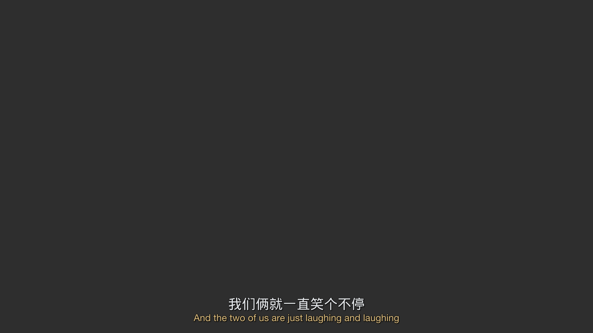
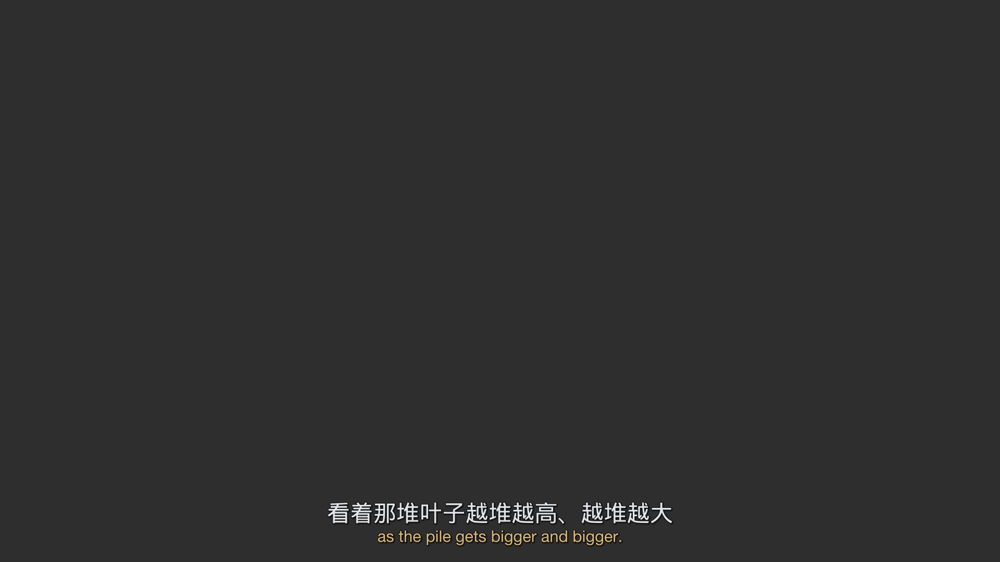
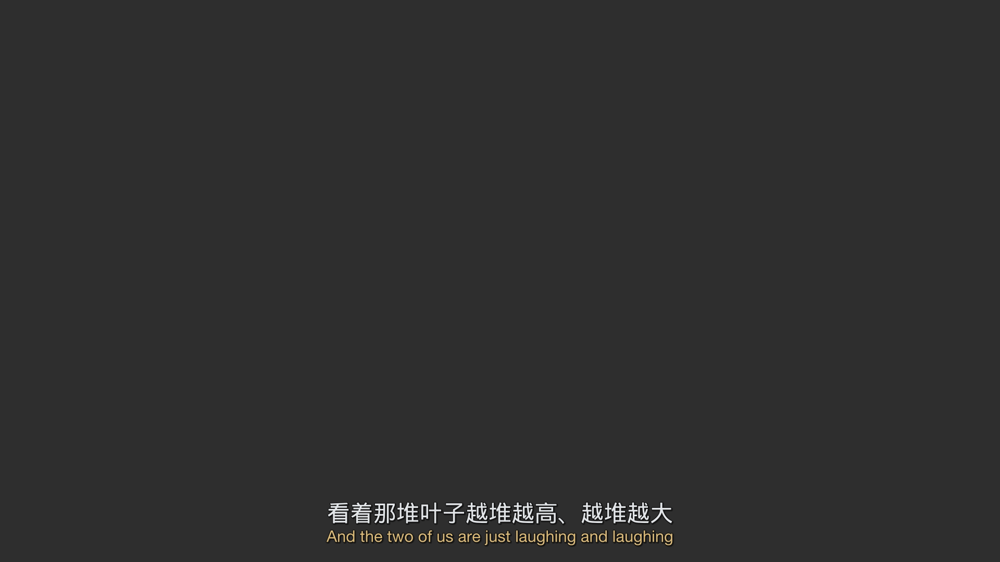

# GLM 与 Gemini：同集字幕编号对齐对比

2026-10-19，在原有独立实验上增加 `group/auto-gfmodel` 对照。未修改生产链。原 Gemini 的源库、映射、请求缓存、ASS、事件审计与图片等 **52 个文件逐一验证 SHA-256 未变**；新产物独立放在 [glm-run](results/dark-matter-s02e07/glm-run/manifest.json)，约 1.44 MB。

## 结论

GLM 对 19 个窗口进行了真实请求，19/19 成功，0 重试。全部原始 JSON 内容符合本实验的结构规范，未发现漏行、非法 ID、重复 ID、重复 JSON 对象键或额外文本。所有连线通过本地校验，没有窗口冲突或漏行补回。

结果接近，但**并非与 Gemini 一致**：697 组（含 layer）相同，Gemini 总共 712 组，GLM 总共 711 组。14 个英文 ID、17 个中文 ID 的组成员关系发生变化，另有两条中文单边字幕的 layer 从 bottom 改为 top。两者不是整集互相替代的等价输出。

指定三段中，01:14、04:12 的分组完全一致；49:40 倒装句则不同：Gemini 合为 M:N，GLM 选择 `E594↔C601`（笑个不停）、`E595↔C600`（叶子越堆越大），两对各自语义成立，渲染后仅显示当下对应中文。这一例比 Gemini 整组中文长驻更精细，但其他差异不一定更好，例如 49:29 的 GLM 1:1 仍有“我爸”跨分句的问题。没有全片人工 ground truth，不能将组一致程度解释成准确率，亦不能据此宣称 GLM 整体更优。

## 可播放文件

GLM 默认字体 ASS：

```text
/Users/maverick/.tds/artifacts/llm-subs-dark-matter-s02e07-01a152fd/glm-run/render/bilingual.ass
```

WenQuanYi Micro Hei 中文字体变体：

```text
/Users/maverick/.tds/artifacts/llm-subs-dark-matter-s02e07-01a152fd/glm-run/render-wqy/bilingual.ass
```

仓库副本：[GLM 字幕](results/dark-matter-s02e07/glm-run/bilingual.ass)、[字体变体](results/dark-matter-s02e07/glm-run/bilingual-wqy.ass)。媒体目录中的字幕与视频未修改。Gemini 路线 A 本机版本仍为 `.../render-chinese-hold/bilingual.ass`，可在播放器手动切换作 A/B 对照。字体未打包，播放器需要安装相应字体。

## 公平对照设置与模型身份

沿用相同的 `sources.json`：英文 stream 2，710 条；简中 stream 6，722 条。无 alass，所有原始时间/纯文本预处理不变。210 秒 core、15 秒上下文重叠、并发 3、逐 cue 时间距离 8 秒上限、单语组跨度 30 秒上限、`max_tokens=16000`、`response_format=json_object`。比较器验证了 **19 个窗口索引和完整请求 payload 除 model 字段外全部相等**。未修改提示词或手工改组。

请求路由 `group/auto-gfmodel` 是用户指定的 GLM-5.3-flash 路由；全部响应 `model` 字段为 **`gfmodel`**，接口未提供完整版本名。Gemini 路由 `group/flash-models` 的响应为 `gemini-3.8-flash-n`。报告保留实际字段，不把路由名当作底层版本的独立证明。

此次使用 JSON object 模式，严格结构与 ID 安全约束由本地执行。19 个实际输出合规，**不证明 GLM 服务端启用了严格 JSON Schema**。本轮未另加 Schema 能力探针；Gemini 首轮不遵守 enum 的探针结论不能自动外推到另一路由。

## 性能与原始响应质量

数据来源：[model-comparison.json](results/dark-matter-s02e07/glm-run/model-comparison.json)，包括逐窗口耗时、原始 ID 检查、usage、完整差异与重点片段。GLM 原始请求与响应在 [首次运行摘要](results/dark-matter-s02e07/glm-run/alignment/initial-run.json) 相邻的 `requests/`。

| 指标 | Gemini | GLM |
| --- | ---: | ---: |
| 真实请求 / 缓存命中 | 19 / 0 | 19 / 0 |
| 成功窗口 / 成功率 | 19 / 100% | 19 / 100% |
| 重试 / 请求失败 | 0 / 0 | 0 / 0 |
| 整集对齐 wall time | 178.290s | 250.196s |
| 请求耗时合计（并发） | 474.068s | 742.034s |
| 请求最小 / 中位 / 最大 | 5.610 / 24.968 / 67.190s | 5.759 / 33.070 / 106.897s |
| prompt_tokens | 80,078 | 71,660 |
| completion_tokens | 76,414 | 72,134 |
| 其中 reasoning_tokens | 60,700 | 59,554 |
| total_tokens | 156,492 | 143,794 |
| 原始 JSON 结构合规窗口 | 19/19 | 19/19 |
| 原始缺失 ID（英/中，按窗口统计） | 0 / 0 | 0 / 0 |
| 原始越窗/不存在 ID | 0 | 0 |
| 原始重复使用 ID | 0 | 0 |
| 本地拒绝行 / 窗口冲突组 | 0 / 0 | 0 / 0 |
| 补回 ID（英/中） | 0 / 0 | 0 / 0 |
| 合法上下文重复组去重 | 59 | 59 |
| 输出 ASS 事件 / 顶部事件 | 720 / 12 | 720 / 14 |
| 渲染耗时（默认字体） | 0.029s | 0.029s |

原始响应检查覆盖精确字段、数组/整数类型（排除 bool）、layer 枚举、空组、组内/组间重复、ID 存在/范围、覆盖完整性、原生位置冲突、远距离与非法聚合跨度；全部 finish_reason 为 stop，content 可直接 JSON 解码，没有 Markdown 围栏。额外检查原始 JSON 对象没有重复键，避免解码覆盖掩盖错误。

本次 GLM wall time 增加 71.906 秒（40.3%）；总 token 减少 12,698（8.1%）。这些是**各一次运行**的实测，不排除网关负载、推理路径和路由的影响；token 来自不同后端报告的 usage，同 payload 的 prompt token 数也不同，不能按其推算实际价格或通用效率排名。

## 对齐决策差异

| 最终映射类型 | Gemini | GLM |
| --- | ---: | ---: |
| 1:1 | 691 | 693 |
| N:1 | 1 | 1 |
| 1:N | 2 | 2 |
| M:N | 7 | 6 |
| 中文单边组 | 11 | 9 |
| 英文单边组 | 0 | 0 |
| 总组数 | 712 | 711 |

697 组含成员与 layer 完全相同；Gemini 独有 15 组，GLM 独有 14 组。中文单边组数减少并非删行：GLM 将 C605–607 合为一个单边组，渲染器仍按三条源字幕分别输出，实际保留的单边源 cue 两者都是 11 条。

以下列出全部有差异的片段及重点一致片段。评价基于源文本与实际渲染，未做全片有声观看。

| 时间 | Gemini 决策 | GLM 决策 | 观察 |
| --- | --- | --- | --- |
| **01:14.032–01:18.661** | E10+11 ↔ C10+11 | 完全相同 | M:N 整组中文长驻，英文换页；75/78 秒采样 PNG 与 Gemini 文件字节完全一致。 |
| **04:12.669–04:22.638** | E45+46 ↔ C46+47 | 完全相同 | M:N 整组中文长驻，2.044s 长停顿保留；254/262 秒采样 PNG 与 Gemini 字节完全一致。 |
| 10:45.312–10:47.189 | C98 单边 bottom | C98 单边 top | “欢迎你 旅者”原生并非 top，GLM 改为 top 是模型位置建议；是否更合适需看画面。 |
| 24:47.821–24:50.324 | E302↔C305、E303↔C306 | 两对合为 M:N | 英语“你… / 你见过我爸爸？”中文“你见过… / 我爸爸？”，GLM 长驻完整中文更适应断句差异，代价是提前显示。 |
| 26:25.711–26:31.550 | E319↔C322、E320↔C323 | 两对合为 M:N | yesterday 在中文前片末尾，GLM 归组长驻；文本较长，需观影判断遮挡。 |
| 44:59.992 附近 | E551↔C554、E552↔C555 | 两对合为 M:N | “拼凑成合理解释”跨英文片段，归组有依据；不意味着 Gemini 1:1 必然错误。 |
| 49:29.261–49:36.851 | E591+592 ↔ C597+598 | 两对按时序拆为 1:1 | E591 含“我爸”、C597 没有，C598 才有；GLM 局部仍不完整，Gemini 长驻保留完整语义，不能据一个倒装例断言 GLM 全面优越。 |
| **49:40.480–49:47.321** | E594+595 ↔ C600+601 | **E594↔C601、E595↔C600** | GLM 交叉配对把“我们一直笑”和“叶子越来越大”各自对上，严格沿英文时间，不受中文原起点误导。两个 1:1 不走 M:N 长驻，不按源中文时间顺序输出；所有中文仍各用一次。 |
| 50:37.663–50:48.507 | C605、606、607 三个单边组 | C605+606+607 一个单边组 | 渲染同样按源时间逐条保留，分组数量变化不改变画面字幕。 |
| 51:32.342–51:36.013 | E607+608 ↔ C616+617 | 两对按时序拆为 1:1 | “调查”在语种间跨分句位置不同，GLM 分组较细并不证明语义更完整。 |
| 52:06.668–52:11.423 | E619+620 ↔ C628+629 | 两对按时序拆为 1:1 | cooperate 在 E619 而“配合”在 C629，仍需听看判断是长驻更合适还是短句更清楚。 |
| 53:10.566–53:13.193 | C639 单边 bottom | C639 单边 top | “十分钟内穿好全部装备”，原生不是 top，GLM 位置建议待观影。 |

51:38 的长三对三（E610–612↔C619–621）两个模型一致，都以整组中文长驻，约四行的遮挡问题也相同。N:1 的问候、1:N 的重复应答，以及其余单边行决策相同。

## 实际排版样例

相同 libass 0.17.3、相同字体、相同 1080p 灰背景，六张采样均无缺字警告，没有越界。灰背景不是视频帧，不能评价镜头、HDR 或真实画面遮挡。检查记录：[visual-check/comparison.json](results/dark-matter-s02e07/glm-run/visual-check/comparison.json)。

GLM 49:43：



GLM 49:46：



Gemini 对照 49:43（整组中文长驻）：



## 复现与校验

命令见 [README 的 GLM 对比段落](README.md)。本轮 `merge.py`、提示词、窗口、校验和渲染逻辑均未改动；只新增离线 `compare_models.py` 与一项原始异常 ID 统计回归测试，测试总数 24 项通过。GLM render 同样对完整源覆盖和逐事件非空白文字回读做验证，720 个事件全部通过；未把最终完整覆盖误当作原模型从未漏行，原响应另行检查。

新 manifest 仅在 `glm-run/`，没有重写 Gemini 原 manifest。原源库与原缓存复用而非重复打包；视频、字体、模型权重和环境不入库。两组的 mapping/source 指纹及 19 份 payload 可离线复核输入等价与决策差异。脚本比较对象是最终组；每个模型的原始响应/拒绝/补回计数另外列出，本次恰好均为 0。

建议先切换两份 ASS 观看 49:40–49:47，再看 49:29、51:32、52:06 这些 GLM 反向拆组的片段。本轮证据支持“可用且大部分组一致、少数决策有明显差异”，不支持“完全一致”或“已有整集准确率结论”。
