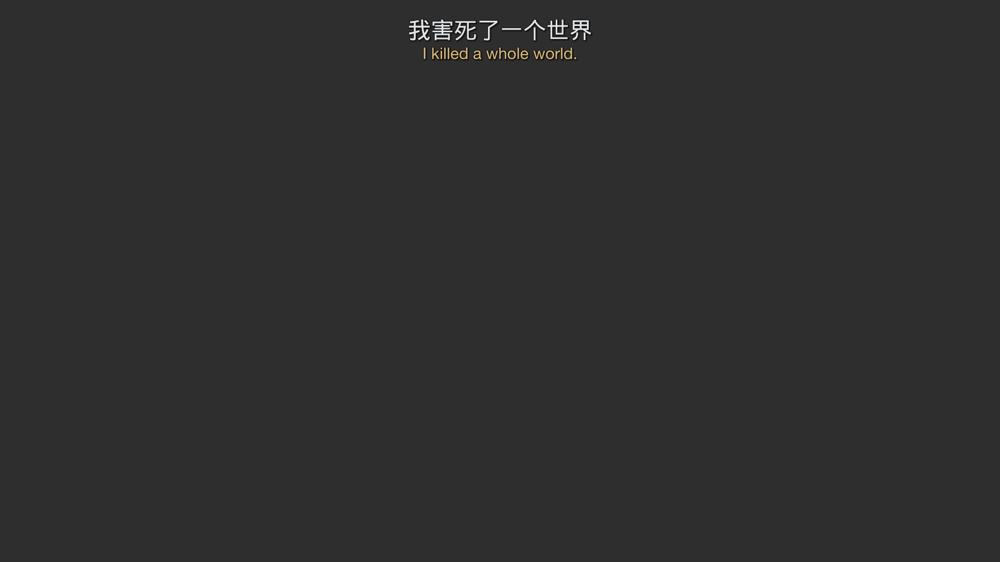
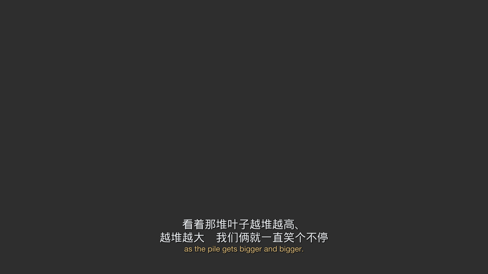
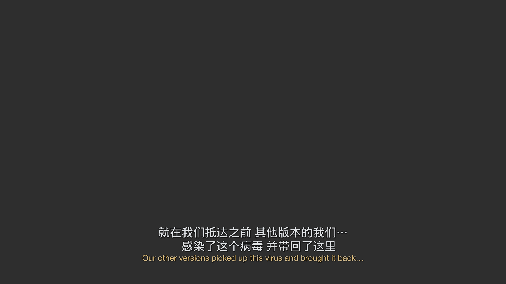
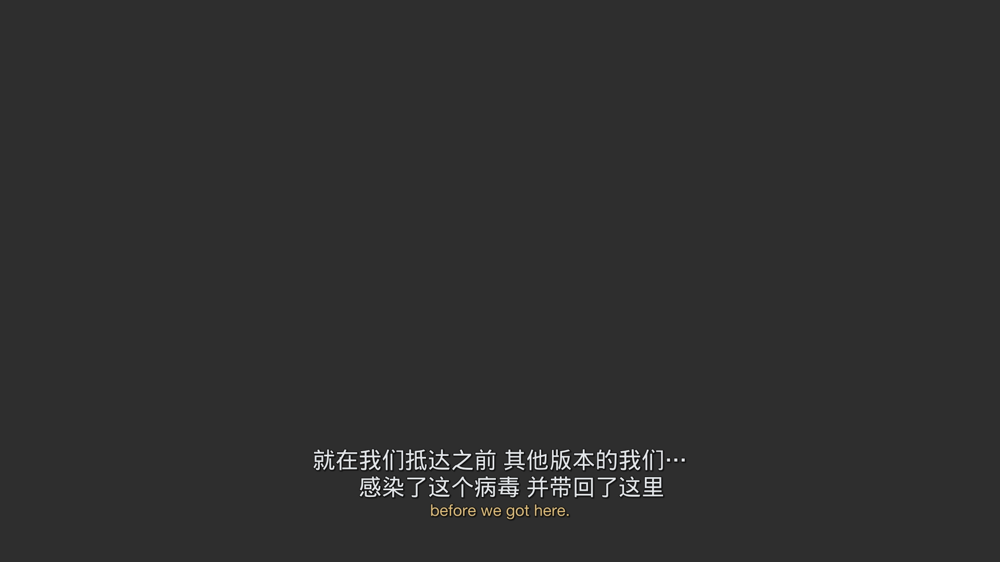
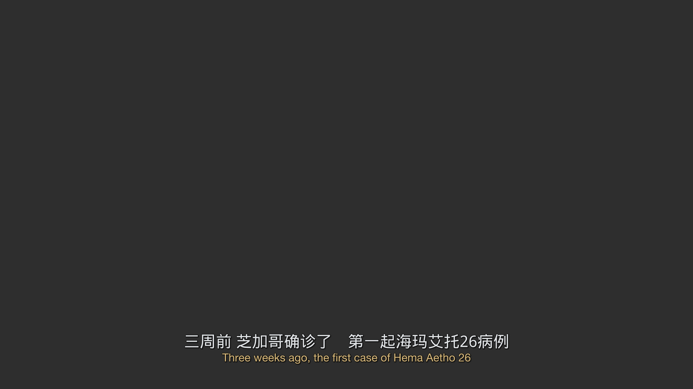
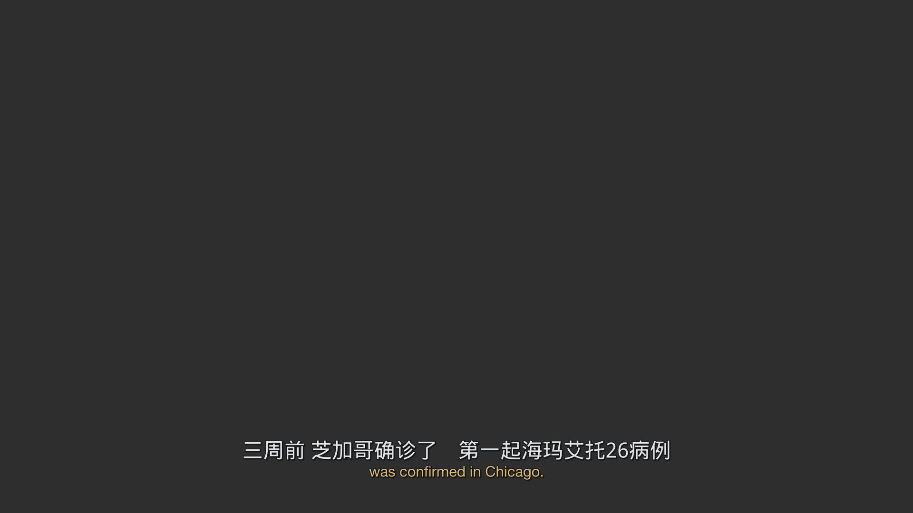
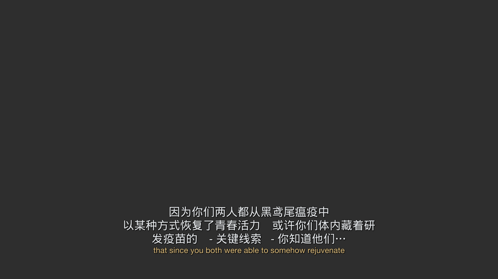

# Dark Matter S02E07：LLM 编号映射双语字幕合并实跑报告

实验日期：2026-10-19。机器：Mac-mini-607.local，macOS arm64。代码和产物仅在本实验目录，不接入 fusionn 的提取/合并/清理生产链。

## 结论

独立流程已对指定这一整集真实调用模型跑通：完整英文 710 条、简中 722 条，经模型映射和本地回填生成 720 个 ASS 事件。19 个模型请求均成功，178.29 秒；映射层没有非法 ID、重复使用、漏行或窗口冲突。本地逐事件回读证明输出的非空白字幕文字均来自选定源字幕；没有把模型生成的句子写入 ASS。

**路线 A 修订已完成：所有 M:N 使用整组中文冻帧长驻、英文逐句翻页，比例分桶已删除。** 复用原映射直接重渲染，新增模型请求/token 均为 0。49:40–49:47、04:12–04:22、01:14–01:18 已实际渲染两次英文翻页采样，完整中文不再按时间猜配到某一英文片段。720 个事件仍全部通过源文字回读校验。

这不等于整集语义准确。长驻规避了上一版倒装分句互相错配的做法，但代价是中文后半提前可见、长组占用更多行，组级模型映射本身仍可能出错。当前结果供观影判断，未接入生产链。

## 如何观看与找到文件

仓库内 [bilingual.ass](results/dark-matter-s02e07/bilingual.ass) 使用方案的 PingFang SC 52 / Helvetica Neue 36、中文上英文下、雾白/暖杏金、1920×1080。字体缺失的播放器可试 [bilingual-wqy.ass](results/dark-matter-s02e07/bilingual-wqy.ass)，它仅把中文字体换成 WenQuanYi Micro Hei；播放器须实际安装相应字体，ASS 没有打包字体。字体变体不改变 ID 或文字。

在本机播放器打开该集视频，再手动加载外置 ASS：

```text
/Users/maverick/.tds/artifacts/llm-subs-dark-matter-s02e07-01a152fd/render-chinese-hold/bilingual.ass
/Users/maverick/.tds/artifacts/llm-subs-dark-matter-s02e07-01a152fd/render-chinese-hold-wqy/bilingual.ass
```

完整本机输出根目录：`/Users/maverick/.tds/artifacts/llm-subs-dark-matter-s02e07-01a152fd/`。它在媒体目录以外，未覆盖媒体或已有 sidecar。仓库中保留约 2.56 MB 的合理大小产物，位于 `experiments/llm-subtitle-merge/results/dark-matter-s02e07/`。视频和字体文件未入库。复现、改字体/字符阈值和测试命令见 [README](README.md)。可在此报告文件的变更预览中阅读图文。

## 输入与选轨

原视频：

```text
/Volumes/External/media/tv/Dark Matter (2024)/Season 02/Dark Matter (2024) - S02E07 - The Pyramid [ATVP][WEBDL-2160p][EAC3 Atmos 5.1][DV HDR10Plus][h265]-FLUX.mkv
```

ffprobe 确认可读，大小 11,904,560,819 字节、片长 3799.588 秒（01:03:19.588）、3840×1920、SAR 1:1、24,000/1001 fps、HEVC 10-bit HDR。只读取，不对视频重编码。本次保留路径/文件大小/mtime 与字幕文件 SHA-256，未额外读取 11.9GB 计算视频全文件哈希。

| 绝对 stream index | language / title | codec | forced | hearing_impaired / SDH | 条数 | 选择 |
| --- | --- | --- | --- | --- | --- | --- |
| 2 | eng / 无 title | subrip | 0 | 0 | 710 | 完整原版英文，采用 |
| 3 | eng / SDH | subrip | 0 | 1 | 896（容器统计） | 未采用 |
| 6 | chi / Simplified | subrip | 0 | 0 | 722 | 完整简体中文，采用 |
| 7 | chi / Traditional | subrip | 0 | 0 | 722（容器统计） | 未采用 |
| 44 | chi / Traditional | subrip | 0 | 0 | 722（容器统计） | 未采用 |

另有阿拉伯语、保加利亚语、捷克语、丹麦语、德语、希腊语、西语两轨、芬兰语、法语两轨、希伯来语、印地语、匈牙利语、意大利语、日语、韩语、拉脱维亚语、挪威语、荷兰语、波兰语、葡语两轨、罗马尼亚语、俄语、泰米尔语、泰卢固语、乌克兰语、越南语等；全部流元数据见 [probe.json](results/dark-matter-s02e07/probe.json)，选中流详情和工具版本见 [extraction.json](results/dark-matter-s02e07/extraction.json)。各语言轨中部分 title 为空，不靠 title 推断为 forced。

用 `ffmpeg -map 0:2/0:6 -c:s copy` 提取到独立新目录，保留 SubRip 的原始标签，提取加探测共 4.578 秒。没有繁简转换、翻译或 SDH 内容清洗。中文字幕末尾翻译署名也保留。

参考依据为已完整阅读的仓库文档 [大模型零幻觉双语字幕合并方案](../../docs/llm-zero-hallucination-bilingual-subtitle-merge.md)，包括后半部分 1:N/M:N、顶部标签、单边与重叠。附件工具提供的签名下载 URL 两次返回 HTTP 404，无法独立校验附件是否逐字相同；未伪称附件下载成功。按任务说明使用仓库现有 501 行参考文本。

## 本机工具、服务和预对齐

- ffmpeg/ffprobe 9.0.2 可用；隔离环境 Python 3.12.15，pysubs2 1.8.0。依赖不写入生产环境。
- 未发现 `alass`，本次未安装/未启用。两条字幕来自同一个 MKV，705 组中英文起止毫秒完全相同；两轨内部各自 0 个重叠，缺乏必须预对齐的证据。保留 `original_start/end` 与实际 `start/end`（本次相同），没有假设 alass 必然改善同源轨。
- `http://127.0.0.1:3425/v1/chat/completions` 无 Authorization 即可调用；没有读取或复制平台私有凭据。`/v1/models` 返回 not_found，改为实际请求验证已知路由。
- 请求模型路由 `group/flash-models`，全部 19 个映射响应的 `model` 为 `gemini-3.8-flash-n`。路由别名不保证将来解析到相同模型；缓存已绑定本次 payload。
- Schema 反向约束测试：prompt 要求 `ids:[1]`，strict JSON Schema 只允许 `[7]`；服务返回 `[1]`。**HTTP 200 和接受 response_format 不证明约束生效，本服务此次没有执行该 enum 约束。** 初次普通格式探针也曾成功返回合法 JSON，但不能抵消反例。脚本实跑使用 `json_object`，完全依赖本地严格结构和引用校验。保存的重复探针与完整响应见 [schema-probe.json](results/dark-matter-s02e07/schema-probe.json)。该文件是为保留可复现证据额外重跑的一次探针。

## 结构、窗口及防丢规则

本地源库保留每条 raw/plain/display、原时间与当前时间、原样式/位置/顶部信息及格式变化列表。模型只看 ID、四舍五入至 0.1s 的时间和 display，精确毫秒不交给模型生成。响应只接受 `alignments`，每组只含整数数组 `en_ids/zh_ids` 与 `layer` 枚举；额外文本字段被拒绝。数组允许单边为空，但不能两边都空。

210 秒 core，前后各 7.5 秒上下文，使相邻输入的名义重叠共 15 秒；跨界的 cue 不截断。组由最早源 cue 的 start 所在 core 拥有。所有窗口观察一并核对，重复上下文组去重；同 ID 的成员/层级不一致则隔离相关 owner 组。缺行或拒绝组的文字按本地源时间单边补回，未使用最近时间自动配对。

校验包括严格类型（bool 不当作整数）、引用存在、窗口范围、组内和组间重复、覆盖完整性、原生顶部冲突、逐 cue 对侧最小区间距离 ≤8 秒、单语组跨度 ≤30 秒以及合法时间。来源指纹与映射指纹绑定，render 时重新校验。首次全部窗口未截断，无重试。参数中 30 秒组跨度是为防异常聚合增加的本地上限，其余主要使用参考建议起点。

短句合并采用英 65 字符、400ms 最大间隔、5.5 秒跨度；中 25 字符、500ms 间隔；小间隙补齐 500ms。以英文外框为锚，不取中英时间并集。保留原生多人破折号，长双人源行可保留换行。1:N 长句外框取英文、内切借中文；N:1 长句按英文切片、中文长驻；所有 M:N（含短组）都按英文逐句切片，每片携带该组全部中文，按原文语序完整合并，不再按时间比例分桶，显式标记 review。中文在双语块上方，保留原生屏幕顶部位置；不把所有 M:N 搬到屏幕顶端。M:N 中文在 25 字符上限内优先按空白/标点均衡换行，避免孤零尾行和行首省略号；按组内最高字幕块预留空间，以顶部锚点固定中文，英文换行行数改变不带动中文。`\\q2` 保持脚本显式换行，不让播放器重新平衡。

重叠保留原始时间，以独立像素带排版，不因重叠 ≤400ms 就裁剪；原生 top 优先，未猜测“短重叠一定不是同时发声”。本集未触发真实重叠分区。单边行全部保留，没有模型决定的 SDH 删除规则；明确删除计数为 0。

## 实跑数据

首次模型运行统计见 [initial-run.json](results/dark-matter-s02e07/alignment/initial-run.json)，全部原始请求与 ID 响应在相邻 `requests/`。最近一次缓存复跑见 [run.json](results/dark-matter-s02e07/alignment/run.json)。

| 指标 | 实测 |
| --- | ---: |
| 输入英文 / 中文 cue | 710 / 722 |
| 窗口 / 并发 | 19 / 3 |
| 首次 HTTP 映射请求 / 重试 / 失败 | 19 / 0 / 0 |
| 首次映射 wall time | 178.29 秒 |
| 各请求耗时合计（并发，非 wall time） | 474.068 秒 |
| 最快 / 最慢映射请求 | 5.610 / 67.190 秒 |
| 服务报告 prompt_tokens | 80,078 |
| 服务报告 completion_tokens（含推理） | 76,414 |
| 其中 reasoning_tokens | 60,700 |
| 服务报告 total_tokens | 156,492 |
| 缓存复跑 / 新请求 / wall time | 19 命中 / 0 / 0.018 秒 |
| 默认字体本地 render（最终一次） | 0.029 秒 |
| ASS 事件 / 顶部事件 | 720 / 12 |
| 被拒绝的连线 / 冲突 owner 组 / 漏行补回 | 0 / 0 / 0 |
| 相同上下文组去重 | 59 |
| 未覆盖源 ID / 重复映射使用源 ID | 0 / 0 |
| 真实重叠导致的排版移动（本集） | 0 |
| 过滤/丢弃源 cue | 0 |

以上 token 为网关返回 usage，未独立用 tokenizer 重计，也未推算价格。19 次是字幕映射请求数，不含前后 3 次能力探针（普通 Schema 1 次、矛盾 Schema 2 次）；探针不计入映射耗时/token。本次重复探针保存于仓库，其余早期探针在构建工具记录中。

| 模型映射类型 | 组数 |
| --- | ---: |
| 1:1 | 691 |
| N:1 | 1 |
| 1:N | 2 |
| M:N | 7 |
| 中文单边 | 11 |
| 英文单边 | 0 |
| 合计 | 712 |

路线 A 重渲染：691 个 1:1 事件、3 个短句合并事件、15 个 M:N 中文整组长驻事件、11 个单边事件，比例分配事件为 0。本轮直接运行 render，未运行 align 或能力探针；默认字体重渲染 0.029 秒，字体变体 0.030 秒，新增 HTTP 请求/token 为 0。原始 19 份请求、mapping/source 指纹和上表模型运行统计未改。7 个 M:N 组（group 9、43、592、594、609、611、618，0-based）均为 review。当前输入的 N:1 与 1:N 都走短合并；长 N:1 和长 1:N 分支由离线测试验证，并未声称这一集自然触发。

纯文本变化可在 [sources.json](results/dark-matter-s02e07/sources.json) 逐 cue 追踪：英文 244 条有格式码/换行解码、223 条展平或首尾空白变化；中文对应 117 / 109 条，3 条过长多人行恢复原行分隔。类别可重叠。原文永远保留于 raw。输出逐事件 ASS 回读后核对所有非空白字形等于源 display；冻帧造成的有意重复有明确的事件 ID 引用，未把“重复显示”混称为“重复映射”。

## 现有双语 sidecar 对照

找到同目录现有 `<video>.zh-CN.ass`，未修改它。SHA-256 为 `f353c05622c197b0964952684257e596803e84b3b262ad0e25e525fe3345152c`，399,665 字节、722 事件。文件的 `Default/Default_1`、字体和 384×288 header 与 fusionn 当前产物形式一致；**文件没有记录实际生成工具/模型/版本，因此只能称现有双语 sidecar，不能伪称已复现某个 DuoSubs 版本的基准。** 本机也没有现成 duosubs CLI，既然已有可直接取用的同输入结果，本次没有安装大型模型栈重跑 DuoSubs。

比较器把 sidecar 按次样式分开两种语言，确认每种语言按顺序去空白后的整段文本分别完全等于本次源轨（英文 17,983 个、中文 7,010 个非空白字符），再按字符偏移恢复源 ID。该方法可识别一个原 cue 在 sidecar 被分割至几个事件的情况；仅比较完整 cue 成员组，不声称复原生成工具内部语义决策。

| 对比项 | 现有 sidecar | 本次 LLM |
| --- | ---: | ---: |
| 渲染事件 | 722 | 720 |
| 恢复的完整 cue 连通组 / 映射组 | 662 | 712 |
| 1:1 | 592 | 691 |
| N:1 | 4 | 1 |
| 1:N | 4 | 2 |
| M:N | 49 | 7 |
| 中文单边 | 13 | 11 |
| 原生/输出顶部事件 | 12 | 12 |

603 组完整成员相同；本次 109 组与现有组不同，对应现有 59 组的合拆变化。**这不是提升率，也不是准确率。** 现有 sidecar 在局部会把一个原英文 cue 的不同片段分给不同中文字幕，恢复连通组会把它们连接起来，因此现有 M:N 组多不能直接解读为错误多。完整差异与例句见 [comparison.json](results/dark-matter-s02e07/comparison.json)。

## 重点抽看片段

下表是读源文本、映射与输出事件所得判断。纯排版样例已经渲染查看；未进行全片有声观看，不对语速、镜头切换或 HDR 实屏观感下结论。

| 时间 | 源 ID / 情况 | 观察与待判断 |
| --- | --- | --- |
| 01:14.032–01:18.661 | E10+E11 ↔ C10+C11，M:N | 英语先说病例再说芝加哥，中文先芝加哥再病例。脚本把完整短中文长驻、英文两次切换，保留英文外框；75s / 78s 两片中文区域像素完全相同，英文正常换页，1ms 正间隙已补齐。单行中文加单行英文无越界，但中文后半提前可见。 |
| 01:30.382–01:34.719 | E15 ↔ C15+C16，1:N | 中文“‘生前’是什么意思？ / 为什么说‘生前’？什么意思？”合并为一行，英文完整显示，短合并符合阈值。观影确认是否宁愿按原中文翻页。 |
| 03:29–03:35（core 边界 03:30） | 重叠窗口 0/1 | 边界两侧 ID 由统一 owner 去重，无冲突或补回；该边界没有发现跨界长语义组。自动测试另外构造了跨界分组意见冲突，不能把无冲突当作所有边界都正确。 |
| 04:12.669–04:22.638 | E45+E46 ↔ C46+C47，M:N | 英语“其他版本感染并带回… / 在我们抵达前”，中文“在我们抵达前 其他版本… / 感染并带回”。已改为两片都显示完整中文，两行中文加一行英文；不再把倒装中文分到相反英文片段。2.044s 长停顿保留，停顿期间整块消失，后一片在同位置恢复。254s 与 262s 实际渲染均无缺字或越界。 |
| 05:38.714–05:40.674 | C50 单边 | 原生顶部“改编自…”保留，无英文空行。 |
| 10:45.312–10:47.189 | C98 单边 | “欢迎你 旅者”保留于源位置（底部），未让模型静默删掉。 |
| 28:46.268–28:48.395 | E337+E338 ↔ C340，N:1 | “Hey. / Hi.”与一句“嗨”，短合并成 Hey. Hi.；模型将两个问候归组，中文只有一个嗨，是否表达两人轮流需听音判断。 |
| 34:42.875–34:45.585 | E420 ↔ C422+C423，1:N | “Yeah.” 对“好的 / 好”，全部保留，不擅删重复中文。是否为两次应答应按原文/声音抽看。 |
| 42:58.118–43:06 左右 | E519–521 / C522–524 | 中英原生顶部位置被保留，非模型凭空决定放顶。样例截图见下。 |
| 48:05.552–48:12.643 | C584–586 单边 | 白板姓名/编号中文顶行独立保留。 |
| 49:29.261–49:36.851 | E591+E592 ↔ C597+C598，M:N | 改为整组中文长驻，包含“我爸”在内的完整中文两片都可见；1.168 秒长停顿保留。 |
| 49:40.480–49:47.321 | E594+E595 ↔ C600+C601，M:N | 旧版倒装反例已改为两片均显示“看着叶子越堆越高、越堆越大　我们俩就一直笑个不停”，两行中文加一行英文。2983s / 2986s 中文区域像素完全相同，英文正常翻页。1ms 正间隙补齐至 2985.027s（ASS 2985.03s），无中文闪烁。 |
| 50:37.663–50:48.507 | C605–607 单边 top | 信件中文按源时间与原 top 连续保留。 |
| 51:32.342–51:36.013 | E607+E608 ↔ C616+C617，M:N | 中文短句长驻、英文换页；公司/立方体修饰语序重排，长驻可提供完整中文。 |
| 51:38.599–51:47.356 | E610–612 ↔ C619–621，M:N | 路线 A 整组三条中文全部长驻，中文约三行加英文一行；多人破折号保留。比旧版更占画面且有提前显示，标记 review，需观影判断长组能否接受。 |
| 52:06.668–52:11.423 | E619+E620 ↔ C628+C629，M:N | 短中文长驻、英文切片，英文外框不扩大至中文并集。 |
| 55:00.512 附近 / 55:19.528 | E655/C665 双人 top；C666 路牌 | 原生上部双人字幕与稍后单边路牌保留。 |
| 63:10.499–63:12.501 | C722 单边 | 翻译署名保留，未把其当对白强配英语。 |

首次 4 张及本轮 7 张排版样例通过本机现有 `fusionn` Docker 容器的 libass 0.17.3 渲染（仅使用 `/tmp/fusionn-llm-01a152fd`，未改服务配置）；宿主 ffmpeg 不含 libass。先用默认 PingFang 渲染出现中文缺字，改成明确可用 WenQuanYi Micro Hei，显式加载该字体和 Helvetica Neue 后样例均无缺字警告。本轮三个指定片段分别取英文翻页前后两帧，另取长 M:N 一帧；均为 1920×1080。字体文件仅用于本机临时校验，未提交。样例使用纯灰背景，不是视频截帧，不能评价 HDR 或真实画面遮挡。

顶部样例（43:04）：



路线 A 倒装片段（49:43），完整中文在上，英文第一片：


49:46 英文第二片，中文不变：



04:14 与 04:22，中文完整保留，英文随原时间翻页：





01:15 与 01:18，中文单行长驻：





三段中文显示文本、显式位置均一致。对纯背景样例的中文区域做像素比较：01:14、49:40 两段差异均为 0；04:12 两帧 215,040 像素区域中 1,359 个像素有差异，集中在字缘，放大查看未见行位变化，未宣称其逐像素完全一致。原始采样时间与测量见 [freeze-check.json](results/dark-matter-s02e07/visual-check/freeze-check.json)。

长中文样例（51:40），约三行中文加一行英文，展示完整中文长驻的遮挡代价：



## 验证与未覆盖项

23 项离线测试已通过（新增所有 M:N 长/短组逐片携带完整中文、长间隙/真实重叠保留、均衡换行及标点、英文行数改变时中文位置固定，以及指定三个真实缓存组回归）：禁止模型带文字字段、非整数/越界/重复/空组、远端 outlier、跨窗口冲突隔离、重叠去重、源指纹变更、顶部标签与原文追踪、非法源时间、英文外框、短合并/长切片/间隙填平、破折号阻止合句、短重叠不裁剪、1:N 内切与非法内切保全、M:N ID 完整性及 review 标记、ASS 回读/单边 SDH/重叠垂直带。实际整集输出再次做完整覆盖和逐事件文字回读验证。所有检查均在实验 Python 环境运行，未跑无关 Go 测试。

真实输入中没有同轨重叠、没有 `pos`、没有需要长 N:1/1:N 的模型组，相关分支只有合成边界测试。ASS 原特效只留审计、不完整复现；位置分区用估计行高，复杂字体回退和多层重叠仍要实机验证。没有人为标注全片 ground truth，不能给出整集语义准确率。

下一步是用新的 Chinese Hold 字幕观看指定片段，重点判断完整中文提前显示、04:12 长停顿期间消失后恢复，以及 51:38 长组约四行文字的遮挡是否可接受。本轮按统一规则处理全部 M:N，没有手工改映射或单独修例；原始输入、映射、请求缓存不变，仓库默认 ASS/events/样例已更新为路线 A。本机旧 `render/` 目录仍是首轮版本，新版路径带 `render-chinese-hold`，请不要混用。
